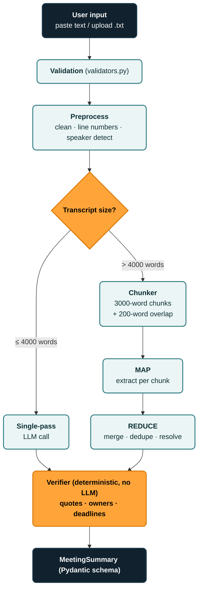

# 🏛️ Meeting Transcript Summarization System Architecture

This subsystem implements a high-throughput, hallucination-resistant **Meeting Transcript Summarization Engine** featuring dynamic transcript routing, boundary-aware Map-Reduce chunking, and deterministic (zero-LLM) quote, owner, and deadline verification.

---

## 📐 Architectural Diagram



---

## 🧩 Architectural Breakdown Bit-by-Bit

### 1. User Input Layer
- **Input Channels**: Accepts raw pasted text via CLI/API or `.txt` file uploads.
- **Payload Flexibility**: Compatible with command line (`cli.py`), REST API (`api.py`), and browser UI (`MeetingSummarizerPage.tsx`).

### 2. Validation (`validators.py`)
- **Format Integrity**: Strict validation ensuring only plain text (`.txt`) files are processed.
- **Encoding Normalization**: Automatic fallback resolution for UTF-8, UTF-8-BOM, Latin-1, and Windows-1252.
- **Guardrails**: Rejects empty strings, whitespace-only submissions, and text under the minimum word threshold (5 words).
- **Sanitization**: Strips null bytes (`\x00`) and non-printable control characters without damaging unicode characters or standard dialogue formatting.

### 3. Preprocess (`preprocessor.py`)
- **Clean**:
  - Normalizes line breaks (`\r\n` and `\r` $\rightarrow$ `\n`).
  - Strips audio/transcript noise: timestamps (`[00:15:30]`, `(12:45)`), audio tags (`[laughter]`, `[applause]`, `[inaudible]`).
  - Standardizes multi-space indentation into single spaces.
- **Line Numbers**:
  - Assigns 1-indexed tags (`[L1]`, `[L2]`, ..., `[LN]`) to every dialogue line.
  - Generates an indexed line dictionary `indexed_lines` enabling instant $O(1)$ reverse lookup for quote verification.
- **Speaker Detect**:
  - Analyzes dialogue turn prefixes (`Alice:`, `[Bob]:`, `**Charlie**:`, `Diana - `).
  - Normalizes and maintains an immutable attendee roster `detected_speakers`.

### 4. Transcript Size Decision & Routing
- **Threshold**: 4,000 words.
- **Path A ($\le 4000$ words) — Single-Pass LLM Call**:
  - Submits the complete preprocessed and numbered transcript in a single LLM context window.
  - Employs strict JSON formatting prompts requiring line-number references for evidence.
- **Path B ($> 4000$ words) — Chunker $\rightarrow$ MAP $\rightarrow$ REDUCE**:
  - **Chunker (`chunker.py`)**:
    - Chunk Size: 3,000 words.
    - Overlap: 200 words.
    - **Line-Boundary Preservation**: Never cuts utterances or sentences in half; walks back to clean line breaks to guarantee coherent context across windows.
  - **MAP**:
    - Runs parallel/sequential chunk extractions extracting chunk-level topics, key decisions, and action items with quotes.
  - **REDUCE**:
    - **Merge**: Synthesizes chunk overviews into a singular cohesive executive overview.
    - **Dedupe**: Eliminates duplicate action items and repeated decisions spanning overlap regions.
    - **Resolve**: Reconciles chronological updates (e.g. earlier tentative deadlines updated later in the meeting).

### 5. Verifier (Deterministic, Zero-LLM) (`verifier.py`)
The verifier enforces zero hallucination without making any LLM calls:
- **`quotes`**:
  - Searches for exact verbatim matches of action item and decision quotes against the indexed lines.
  - Confirms and assigns exact line references (`[L...]`).
  - Flags any fabricated or paraphrased quotes as hallucinations (`quote_verified = False`).
- **`owners`**:
  - Matches assigned owners against the `detected_speakers` registry.
  - Accepts exact names and tokenized names (e.g. "Alice" matches "Alice Johnson").
  - Rejects unknown or hallucinated assignees.
- **`deadlines`**:
  - Parses date formats (ISO `YYYY-MM-DD`, relative phrases like `EOD`, `end of week`, `next Friday`, `within 2 weeks`).
  - Validates calendar dates using deterministic date parsing.
- **Audit Telemetry**:
  - Produces a detailed `VerificationReport` with pass rates and identified discrepancies.

### 6. MeetingSummary Schema (`models.py`)
Strict Pydantic v2 schema serializable to JSON:
- `title`: str
- `meeting_date`: Optional[str]
- `attendees`: List[str]
- `overview`: str
- `key_points`: List[KeyPoint]
- `decisions`: List[Decision]
- `action_items`: List[ActionItem]
- `verification_report`: VerificationReport
- `metadata`: TranscriptMetadata (raw_word_count, clean_word_count, routing_path, num_chunks, processing_time_sec)

---

## 🚀 Execution & Usage

### 1. CLI Usage
```bash
# Summarize a text file:
py -3.9 backend/cli.py --file path/to/transcript.txt

# Summarize raw text:
py -3.9 backend/cli.py --text "Alice: We need to ship by Friday. Bob: I will test it tomorrow."

# Specify output JSON file:
py -3.9 backend/cli.py --file meeting.txt --output summary.json
```

### 2. FastAPI REST Server
```bash
# Launch FastAPI backend:
py -3.9 -m uvicorn backend.api:app --reload --port 8000

# Endpoint to summarize raw text:
POST http://127.0.0.1:8000/api/summarize/text
Content-Type: application/json
{ "text": "...", "provider": "auto" }

# Endpoint to upload file:
POST http://127.0.0.1:8000/api/summarize/file (multipart/form-data)
```

### 3. Run Unit & Integration Tests
```bash
py -3.9 -m pytest backend/test_summarizer.py -v
```

### 4. Interactive Web Interface
Navigate to `/summarizer` in the Vite web application to paste transcripts or upload `.txt` files with real-time routing previews and verifier scorecards.

