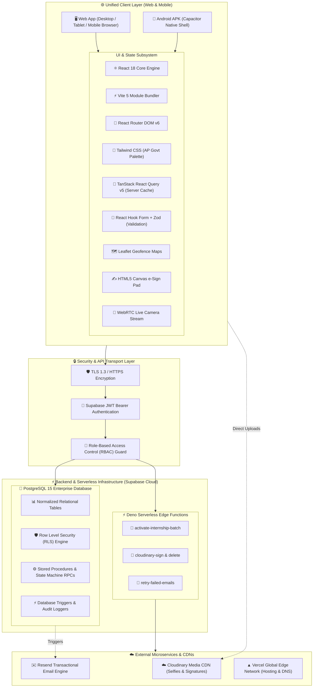
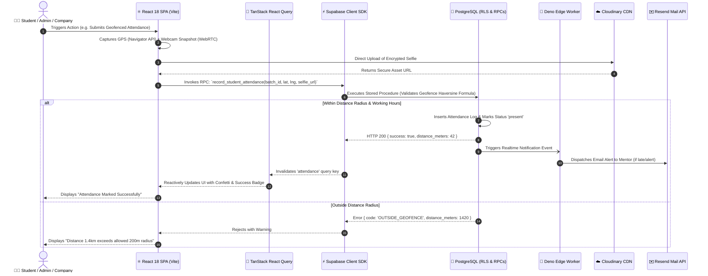
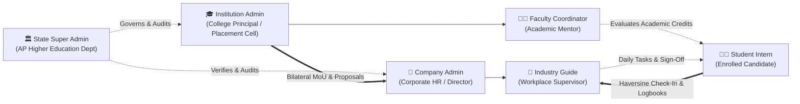
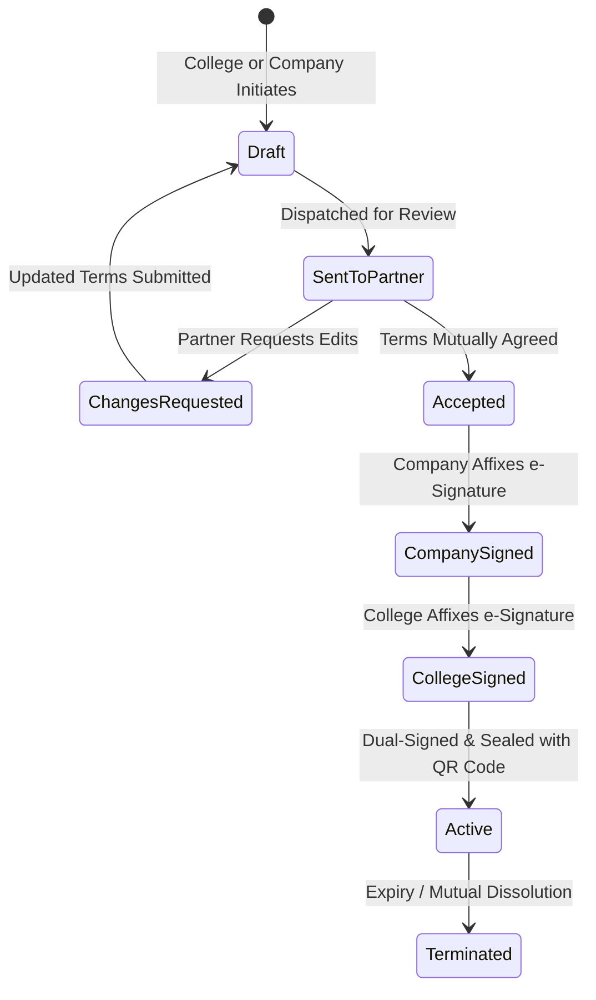
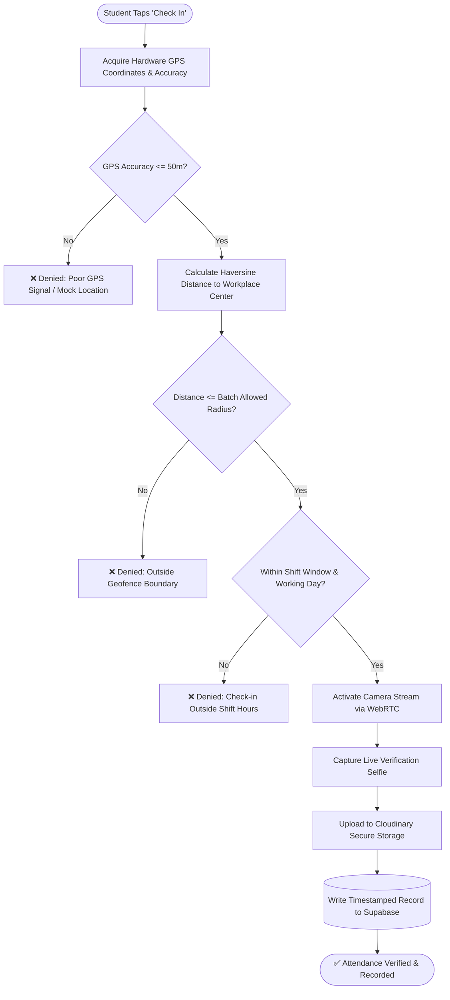
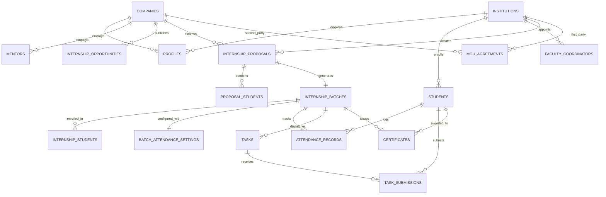

# 🎓 AP VidyaConnect (ఆంధ్రప్రదేశ్ విద్యాకనెక్ట్)
### State Unified Internship, Dual-Signature MoU & Industry Collaboration Platform
**An official digital initiative developed by PixelWind Technologies for the Department of Higher Education, Government of Andhra Pradesh.**

---

[](LICENSE)
[](https://reactjs.org/)
[](https://www.typescriptlang.org/)
[](https://tailwindcss.com/)
[](https://vitejs.dev/)
[](https://supabase.com/)
[](https://capacitorjs.com/)
[](https://www.education.gov.in/nep)
[](https://www.meity.gov.in/)

---

## 📑 Table of Contents
1. [🏛️ Executive Overview](#️-executive-overview)
2. [🏗️ Overall System Architecture](#️-overall-system-architecture)
   - [End-to-End Architectural Diagram](#end-to-end-architectural-diagram)
   - [Frontend Architecture Bit-by-Bit](#frontend-architecture-bit-by-bit)
   - [Backend & Cloud Architecture Bit-by-Bit](#backend--cloud-architecture-bit-by-bit)
   - [Client-Server Data Flow Lifecycle](#client-server-data-flow-lifecycle)
3. [💻 Technologies Used (Explained Bit-by-Bit & Point-by-Point)](#-technologies-used-explained-bit-by-bit--point-by-point)
   - [Frontend Technologies](#frontend-technologies)
     - [What is React?](#what-is-react)
     - [What is TypeScript?](#what-is-typescript)
     - [What is Vite?](#what-is-vite)
     - [What is Tailwind CSS?](#what-is-tailwind-css)
     - [What is TanStack React Query?](#what-is-tanstack-react-query)
     - [What is React Hook Form & Zod?](#what-is-react-hook-form--zod)
     - [What is React Router DOM?](#what-is-react-router-dom)
     - [What is Leaflet?](#what-is-leaflet)
     - [What is Recharts?](#what-is-recharts)
     - [HTML5 Canvas & WebRTC Camera APIs](#html5-canvas--webrtc-camera-apis)
     - [What is Capacitor (Android Mobile)?](#what-is-capacitor-android-mobile)
   - [Backend & Cloud Infrastructure Technologies](#backend--cloud-infrastructure-technologies)
     - [What is Supabase?](#what-is-supabase)
     - [What is PostgreSQL?](#what-is-postgresql)
     - [What is Row Level Security (RLS)?](#what-is-row-level-security-rls)
     - [What are PostgreSQL Stored Procedures & RPCs?](#what-are-postgresql-stored-procedures--rpcs)
     - [What are Deno Edge Functions?](#what-are-deno-edge-functions)
     - [What is Cloudinary CDN?](#what-is-cloudinary-cdn)
     - [What is Resend?](#what-is-resend)
     - [What is Vercel?](#what-is-vercel)
4. [👥 Multi-Role Portal Modules & Work Breakdown](#-multi-role-portal-modules--work-breakdown)
   - [1. State Super Admin Module & Work](#1-state-super-admin-module--work)
   - [2. Corporate Company Admin Module & Work](#2-corporate-company-admin-module--work)
   - [3. Higher Education Institution Admin Module & Work](#3-higher-education-institution-admin-module--work)
   - [4. Faculty Coordinator Module & Work](#4-faculty-coordinator-module--work)
   - [5. Industry Mentor / Workplace Guide Module & Work](#5-industry-mentor--workplace-guide-module--work)
   - [6. Enrolled Student / Intern Module & Work](#6-enrolled-student--intern-module--work)
5. [⚙️ Core Platform Functional Modules](#️-core-platform-functional-modules)
   - [Bilateral MoU Negotiation & Execution Engine](#bilateral-mou-negotiation--execution-engine)
   - [Haversine Geofenced Attendance & Biometric Engine](#haversine-geofenced-attendance--biometric-engine)
   - [Task Management & Daily Logbook Module](#task-management--daily-logbook-module)
   - [NEP 2020 Academic Credit Evaluation Engine](#nep-2020-academic-credit-evaluation-engine)
   - [VidyaBot 3D AI Assistant Module](#vidyabot-3d-ai-assistant-module)
   - [Promotional Banner & Broadcast Manager](#promotional-banner--broadcast-manager)
   - [Real-Time Notification & Transactional Email System](#real-time-notification--transactional-email-system)
6. [🗄️ Relational Database Schema & Data Models](#️-relational-database-schema--data-models)
7. [🛡️ Security, Privacy & DPDP Act 2023 Compliance](#️-security-privacy--dpdp-act-2023-compliance)
8. [📱 Mobile Android APK Setup (Capacitor)](#-mobile-android-apk-setup-capacitor)
9. [🛠️ Local Development & Deployment Guide](#️-local-development--deployment-guide)
10. [📞 Support & Institutional Contact](#-support--institutional-contact)

---

## 🏛️ Executive Overview

**AP VidyaConnect (ఆంధ్రప్రదేశ్ విద్యాకనెక్ట్)** is an enterprise-grade digital governance platform engineered to unify and standardize the entire internship and industry collaboration ecosystem across all **26 districts of Andhra Pradesh**. 

Prior to this platform, internship MoUs, student allocations, daily attendance logs, and academic credit evaluations were fragmented across disparate paper files, informal spreadsheets, and unverified letters. **AP VidyaConnect** establishes an immutable, cryptographically verifiable, and automated state-wide digital infrastructure connecting:
- **Higher Education Institutions**: Universities, Autonomous Engineering Colleges, Government Degree Colleges, and Polytechnics.
- **Industrial Enterprises**: Registered IT corporations, MSMEs, manufacturing plants, hospitals, and research laboratories.
- **Department of Higher Education**: State nodal authorities overseeing academic standards, equity, and National Education Policy (NEP 2020) compliance.
- **Students & Faculty**: Hundreds of thousands of aspiring interns and academic guides tracking experiential learning in real time.

---

## 🏗️ Overall System Architecture

The architecture of **AP VidyaConnect** follows a decoupled, resilient, cloud-native **Single Page Application (SPA)** and **Backend-as-a-Service (BaaS)** pattern, augmented with serverless Edge Functions, high-speed CDNs, and transactional microservices.

### End-to-End Architectural Diagram



---

### Frontend Architecture Bit-by-Bit

The frontend is built as a single-page application (SPA) prioritizing zero-latency page transitions, responsive layouts, accessibility, and high data density for state administrators.

- **Component Layering**: UI components are categorized strictly into:
  - `components/layout/`: Global wrappers (`AppLayout`, `PublicLayout`, `Header`, `Sidebar`, `Footer`).
  - `components/common/`: Reusable primitive and state-specific widgets (`BrandLogo`, `GovernmentBackground`, `Card`, `VidyaBotChatbot`, `AppSplashScreen`).
  - `components/mou/`: MoU document rendering, live clause customizers, and dual HTML5 canvas signature capture modals.
  - `components/attendance/`: Interactive Leaflet map radius selector, GPS coordinate picker, and webcam selfie verification modal.
  - `components/batches/`: Dynamic batch activation dialogs, email dispatch status monitors, and student roster modals.
  - `components/admin/`: Entity verification dossiers, district-wise filter tables, and announcement banner managers.
- **State Management Strategy**:
  - **Server State**: Managed exclusively through **TanStack React Query (v5)**. Server queries (MoUs, proposals, batches, attendance logs) are cached, deduplicated, and refetched automatically in the background.
  - **Authentication State**: Managed via a global `AuthContext` backed by Supabase Auth with automatic token refreshing and session persistence in `localStorage`.
  - **UI / Modal State**: Managed via `ModalContext` and `NotificationContext` to orchestrate multi-step approval dialogs, live toaster popups, and full-screen alerts without prop-drilling.
- **Routing & Route Protection**:
  - `src/App.tsx` configures a declarative routing table using **React Router DOM v6**.
  - Protected routes (`/dashboard`, `/proposals`, `/batches`, `/attendance`, `/mous`, `/admin/*`) are encapsulated inside `<AppLayout />` which enforces role-based redirection. Unauthorized roles attempting to access restricted URLs are immediately intercepted and rerouted.

---

### Backend & Cloud Architecture Bit-by-Bit

Rather than maintaining a heavy, monolithic server that requires continuous patch maintenance and scaling overhead, the backend leverages **Supabase** (an enterprise-grade Postgres platform) alongside **Deno Edge Functions**.

- **Database-Level Multi-Tenancy**: The database enforces isolation directly at the database engine using **PostgreSQL Row Level Security (RLS)**. Even if an attacker attempts to inject malicious SQL through the client, PostgreSQL automatically appends security constraints based on the authenticated user's JWT claim (`auth.uid()`).
- **Atomic State Transitions (RPCs)**: Business operations that alter financial, legal, or batch states (such as accepting a proposal, creating an internship batch, or approving an MoU) do not execute via client-side CRUD operations. Instead, they call **PostgreSQL Stored Procedures (RPCs)** marked with `SECURITY DEFINER`. These run as atomic database transactions: either all related records update simultaneously or the entire operation rolls back.
- **Deno Edge Functions**: For workflows requiring external secret keys (such as signing Cloudinary private uploads or dispatching batched emails via Resend), lightweight Deno TypeScript functions execute on edge servers close to the end user with sub-50ms cold starts.
- **Media & Document Storage**: Live biometric selfies, cropped signature PNGs, and college/company incorporation certificates are offloaded to **Cloudinary CDN** with content delivery optimization and automated image compression.

---

### Client-Server Data Flow Lifecycle



---

## 💻 Technologies Used (Explained Bit-by-Bit & Point-by-Point)

### Frontend Technologies

#### What is React?
**React (v18.2 / v18.3)** is the industry-standard declarative, component-based JavaScript/TypeScript library developed and maintained by Meta (Facebook) and an open-source community.
- **Why it is used in AP VidyaConnect**:
  - **Component-Based Architecture**: Breaks the complex state portal into modular, reusable UI blocks (such as Signature Pads, Geofence Maps, Navigation Drawers, and Stat Cards).
  - **Virtual DOM (VDOM) & Fiber Reconciliation**: Ensures that updates to large real-time student tables or daily attendance feeds only re-render the specific DOM nodes that changed, avoiding costly full-page re-renders.
  - **Declarative Hooks**: Leverages modern hooks (`useState`, `useEffect`, `useContext`, `useRef`, `useMemo`, `useCallback`) for granular lifecycle and memory management.
  - **Unidirectional Data Flow**: State flows top-down through props and contexts, making data mutations predictable and straightforward to debug.

#### What is TypeScript?
**TypeScript (v5.2 / v5.5)** is a strongly-typed programming language that builds on JavaScript by adding static type definitions developed by Microsoft.
- **Why it is used in AP VidyaConnect**:
  - **Compile-Time Safety**: Catches syntax errors, null-pointer exceptions, and misspelled properties during code writing rather than in the hands of government officials or students.
  - **Database Model Synchronicity**: Every PostgreSQL table schema, ENUM, and RPC signature is mirrored directly in `src/types/database.ts`. If a database column name changes, TypeScript immediately highlights every component that needs updating.
  - **Intellisense & Autocompletion**: Accelerates development by giving exact type suggestions for complex state machines, proposal statuses, and geofence coordinates.

#### What is Vite?
**Vite (v5.1)** is a next-generation frontend build tool created by Evan You (creator of Vue.js) that drastically improves developer experience and build performance.
- **Why it is used in AP VidyaConnect**:
  - **Native ES Modules (ESM)**: During local development, Vite serves source code over native ESM, eliminating slow bundling steps and achieving near-instant dev server boot times (<300ms).
  - **Lightning-Fast Hot Module Replacement (HMR)**: Changes made to styles, forms, or legal clauses appear in the browser instantly without losing form state.
  - **Optimized Production Bundling**: Uses Rollup under the hood to perform code-splitting, tree-shaking, and chunk minification, generating an ultra-compact production bundle.

#### What is Tailwind CSS?
**Tailwind CSS (v3.4)** is a utility-first CSS framework packed with classes that can be composed directly in markup to build custom designs without writing custom CSS files.
- **Why it is used in AP VidyaConnect**:
  - **Custom Government Design System**: Preconfigured with the official Andhra Pradesh State Government identity tokens:
    - Primary Navy Blue: `#0E2350` / `#163A7A` (symbolizing institutional authority and trust)
    - Vibrant Saffron: `#F07421` / `#D45D0E` (symbolizing energy, skill development, and progress)
    - Emerald Green: `#16A34A` / `#22C55E` (indicating verified status, presence, and approvals)
  - **Zero CSS Bloat**: Tailwind’s Just-in-Time (JIT) compiler scans all `.tsx` files and generates only the CSS classes that are actually used, resulting in tiny CSS bundle sizes (<25KB gzipped).
  - **Flawless Responsiveness**: Native breakpoint prefixes (`sm:`, `md:`, `lg:`, `xl:`) ensure that everything from state dashboards to attendance camera capture adapts seamlessly to mobile phones, tablets, and high-res monitors.

#### What is TanStack React Query?
**TanStack React Query (v5.28)** is the premier asynchronous server-state management library for web applications.
- **Why it is used in AP VidyaConnect**:
  - **Eliminates Manual Loading/Error States**: Automates data fetching lifecycles with built-in `isLoading`, `isError`, and `data` properties.
  - **Intelligent Caching & Stale-While-Revalidate**: Caches district rosters, batch data, and MoU details in memory, instantly rendering cached data while silently synchronizing the latest updates from Supabase.
  - **Automatic Query Invalidation**: When an action occurs (e.g., signing an MoU or approving a student), `queryClient.invalidateQueries({ queryKey: ['mous'] })` automatically triggers a background refetch so all views remain synchronized.

#### What is React Hook Form & Zod?
- **React Hook Form (v7.51)** is a high-performance, minimal-overhead form library that uses uncontrolled components and React `ref`s to minimize re-renders.
- **Zod (v3.22)** is a TypeScript-first schema declaration and runtime validation library.
- **Why they are used in AP VidyaConnect**:
  - Proposal creation, company registration, and geofence configuration require validating dozens of inputs (GSTIN formats, AISHE codes, latitude/longitude bounds, student rosters).
  - Zod schemas validate user inputs with custom error messages before the network request is ever dispatched, while React Hook Form ensures the UI never stutters during typing.

#### What is React Router DOM?
**React Router DOM (v6.22)** is the standard routing library for React applications.
- **Why it is used in AP VidyaConnect**:
  - Enables declarative client-side navigation without triggering full browser reloads.
  - Implements **Nested Layouts**:
    - `<PublicLayout />` for the landing page, institutional network, partner directory, FAQ, and privacy policy.
    - `<AppLayout />` for authenticated workspaces, complete with responsive collapsible navigation bars, active status indicators, and notification bells.
  - Supports dynamic URL parameters (`/mous/:id`, `/batches/:id`, `/partners/:id`).

#### What is Leaflet?
**Leaflet (v1.9)** is the leading open-source JavaScript library for mobile-friendly interactive maps.
- **Why it is used in AP VidyaConnect**:
  - Powers the **Visual Geofence Configuration Engine**.
  - Companies and administrators can drag a pin across an interactive map to pinpoint their workplace premises, and dynamically adjust a visual circular radius overlay (50m, 100m, 200m, 500m, 1000m) to preview the exact physical boundary within which students are permitted to check in.

#### What is Recharts?
**Recharts (v2.12)** is a composable, declarative charting library built on React components and SVG.
- **Why it is used in AP VidyaConnect**:
  - Renders live state-wide analytical visualizations on the Super Admin and College dashboards.
  - Displays district-wise internship distribution bar charts, weekly attendance trend line graphs, and industry sector breakdown pie charts.

#### HTML5 Canvas & WebRTC Camera APIs
- **HTML5 Canvas API**: Drives the dual-party electronic signature engine. It captures high-resolution pointer, touch, and mouse events, smooths the Bézier curves, crops extraneous white padding, and exports transparent PNG signatures ready for legal sealing.
- **WebRTC `navigator.mediaDevices.getUserMedia`**: Direct browser-to-hardware interface enabling the student attendance module to access front-facing cameras for live selfie capture without relying on external native plugins.

#### What is Capacitor (Android Mobile)?
**Capacitor (v8.5)** by Ionic is a cross-platform native runtime that deploys modern web apps to iOS and Android.
- **Why it is used in AP VidyaConnect**:
  - Wraps the entire React application into a standalone Android APK (`ap-vidyaconnect.apk`).
  - Provides direct access to native device features, including high-precision hardware GPS telemetry, hardware camera controls, and native animated splash screen transitions (`AppSplashScreen.tsx`).

---

### Backend & Cloud Infrastructure Technologies

#### What is Supabase?
**Supabase** is an open-source Backend-as-a-Service (BaaS) built on top of enterprise-grade PostgreSQL.
- **Why it is used in AP VidyaConnect**:
  - Provides a complete backend solution out of the box: a relational database, built-in user authentication (JWT-based), instant RESTful APIs generated from the database schema, real-time WebSocket listeners, and serverless compute.
  - Eliminates the maintenance burden of running custom Express/Django servers, allowing the team to focus entirely on governance business logic.

#### What is PostgreSQL?
**PostgreSQL (Postgres)** is the world's most advanced, reliable open-source object-relational database system with more than 35 years of active development.
- **Why it is used in AP VidyaConnect**:
  - **ACID Compliance**: Guarantees Atomicity, Consistency, Isolation, and Durability for high-stakes government MoUs, credit allocations, and attendance logs.
  - **Rich Data Types**: Supports native `UUID`, `TIMESTAMP WITH TIME ZONE`, `JSONB` (for storing version snapshots, custom clauses, and feedback history), and custom `ENUM` types.
  - **Foreign Key Integrity**: Enforces strict relational constraints between colleges, companies, students, batches, and attendance records, eliminating orphaned records.

#### What is Row Level Security (RLS)?
**Row Level Security (RLS)** is a native PostgreSQL security feature that restricts which rows in a database table can be viewed or modified based on the current user's session context (`auth.uid()`).
- **Why it is used in AP VidyaConnect**:
  - In a standard web application, authorization logic resides in backend code (e.g. Express middleware). If a developer forgets an authorization check, users could access other tenants' data.
  - With RLS, the database itself rejects unauthorized queries. For example, a student attempting to run `SELECT * FROM attendance_records` will strictly receive only their own attendance rows because Postgres automatically enforces:
    ```sql
    CREATE POLICY "Students view own attendance" ON attendance_records
    FOR SELECT USING (student_id IN (
      SELECT id FROM students WHERE auth_user_id = auth.uid()
    ));
    ```

#### What are PostgreSQL Stored Procedures & RPCs?
**Remote Procedure Calls (RPCs)** in Supabase are custom functions written in **PL/pgSQL** executed directly inside the database engine.
- **Why they are used in AP VidyaConnect**:
  - Used for state-machine operations that require multiple coordinated table mutations.
  - When an admin activates an internship batch:
    1. The proposal status transitions to `batch_created`.
    2. The batch record is inserted.
    3. The student roster is mapped from `proposal_students` to `internship_students`.
    4. Initial attendance configuration defaults are generated.
    5. An immutable audit trail entry is recorded.
  - By wrapping this entire pipeline in an atomic PL/pgSQL function executed with `SECURITY DEFINER`, any failure midway automatically rolls back all changes, preventing corrupted or half-created batches.

#### What are Deno Edge Functions?
**Deno Edge Functions** are lightweight serverless functions executed on distributed edge runtimes powered by the V8 JavaScript engine.
- **Why they are used in AP VidyaConnect**:
  - Ideal for background processing and integrating third-party APIs where secret API keys (Cloudinary API Secret, Resend API Key) must remain hidden from the frontend client.
  - Includes functions for:
    - `activate-internship-batch`: Provisions student credentials and triggers onboarding workflows.
    - `cloudinary-sign`: Generates cryptographic HMAC SHA-1 signatures for private media uploads.
    - `retry-failed-emails`: Automated cron-driven retry worker for failed email dispatches.

#### What is Cloudinary CDN?
**Cloudinary** is a cloud-based end-to-end media management platform.
- **Why it is used in AP VidyaConnect**:
  - Safely stores and serves sensitive binary media: student attendance selfies, official college accreditation PDFs, corporate registration certificates, and extracted digital canvas signatures.
  - Automatically converts uploaded images into next-gen formats (WebP, AVIF) with lossless compression, ensuring high-speed rendering across rural mobile networks in Andhra Pradesh.

#### What is Resend?
**Resend** is an enterprise-grade transactional email service built for modern developers.
- **Why it is used in AP VidyaConnect**:
  - Dispatches automated, high-deliverability emails containing:
    - Legal bilateral MoU contracts with attached PDF links.
    - Proposal revision notices between colleges and corporate partners.
    - Student login credential dossiers and batch onboarding invitations.
    - Geofence attendance anomaly alerts to mentors.

#### What is Vercel?
**Vercel** is the cloud platform for static and edge-rendered frontend applications.
- **Why it is used in AP VidyaConnect**:
  - Delivers global edge routing, automatic continuous integration/continuous deployment (CI/CD) directly from the GitHub repository, automatic SSL certificate provisioning, and instant rollbacks.

---

## 👥 Multi-Role Portal Modules & Work Breakdown

The platform provides dedicated, role-tailored workspaces for six distinct stakeholders:



---

### 1. State Super Admin Module & Work
*Target Stakeholders: State Nodal Officers, Directorate of Higher Education, Andhra Pradesh State Council of Higher Education (APSCHE).*

- **Role & Objective**: Acts as the supreme governing authority ensuring that all higher education institutions and corporate partners comply with state policies, UGC norms, and NEP 2020 guidelines.
- **Key Responsibilities & Detailed Work ("His Work")**:
  - **Entity Verification Dossier Audit**:
    - Inspects newly registered colleges and universities. Checks AISHE code, affiliating university, principal credentials, and official accreditation certificates.
    - Inspects newly registered companies. Checks Corporate Identification Number (CIN), GSTIN, authorized signatory proof, and official corporate domains.
    - Approves, rejects, or flags entities for clarification with detailed audit notes.
  - **State-Wide 26-District Analytics Dashboard**:
    - Monitors real-time key performance indicators (KPIs): Total Active MoUs, Total Batches in Progress, Total Students Interning, Total Verified Check-ins, and Total Academic Credits Earned.
    - Filters data by district (Visakhapatnam, Vijayawada, Guntur, Tirupati, Kurnool, etc.) and institution type (Government Degree College, Autonomous University, Polytechnic).
  - **Promotional & Broadcast Banner Management**:
    - Creates state-wide announcements, scholarship broadcasts, and skill drives.
    - Configures targeting (broadcast to Students, Colleges, Companies, or Global), customizes visual gradient themes, and sets CTA action links.
  - **Compliance & Immutable Security Audit Log**:
    - Reviews the state-wide audit log (`audit_logs` table) tracking every critical action (who signed which MoU, coordinate changes to geofences, and manual attendance overrides) with actor ID, timestamp, and IP address.

---

### 2. Corporate Company Admin Module & Work
*Target Stakeholders: HR Directors, Corporate Training Heads, Managing Directors, Industry Recruiters.*

- **Role & Objective**: Represents industrial enterprises seeking skilled interns, enabling them to formalize institutional partnerships and manage workplace operations.
- **Key Responsibilities & Detailed Work ("His Work")**:
  - **Internship Opportunity Publishing**:
    - Creates public opportunity listings specifying domain (Full Stack, AI/ML, Embedded Systems, Digital Marketing), stipend amount, available seats, eligible degrees, minimum CGPA, and prerequisite skills.
  - **Proposal Negotiation & Counter-Proposals**:
    - Receives structured batch proposals from colleges.
    - Reviews candidate rosters and requested terms.
    - Accepts proposals directly or submits a formal counter-proposal (adjusting stipend, shifting start dates, or modifying seat counts) which moves the proposal through the state machine.
  - **Bilateral MoU Execution**:
    - Reviews standardized AICTE legal clauses and custom cooperation terms.
    - Digitally signs the legal MoU using the HTML5 canvas signature pad.
    - Receives cryptographically sealed, dual-signed PDF agreements.
  - **Intelligent Geofence & Shift Boundary Configuration**:
    - Sets physical workplace coordinates (latitude & longitude) using the interactive Leaflet map.
    - Configures allowed check-in radius (50m, 100m, 200m, 500m, 1000m).
    - Defines shift schedules (start time, end time, grace periods, half-day cutoffs, and weekly off days).
  - **Industry Mentor Roster Management**:
    - Assigns workplace mentors and supervisors to active batches to oversee daily student execution.

---

### 3. Higher Education Institution Admin Module & Work
*Target Stakeholders: College Principals, Deans of Academic Affairs, Heads of Training & Placement (TPO).*

- **Role & Objective**: Manages college-level internship programs, executes formal corporate agreements, and ensures student rosters fulfill academic degree requirements.
- **Key Responsibilities & Detailed Work ("His Work")**:
  - **Batch Proposal Builder**:
    - Selects verified corporate partners from the state directory.
    - Curates student rosters by branch, department, and academic year.
    - Defines proposed duration, academic objectives, and requested stipends, then dispatches the proposal to the company.
  - **Student Roster & Ingestion**:
    - Performs bulk student onboarding via CSV ingestion or manual registration.
    - Tracks student account activations, temporary password distributions, and profile verifications.
  - **MoU Initiation & Legal Countersigning**:
    - Initiates bilateral MoUs with partnering companies.
    - Signs on behalf of the institution using the interactive digital signature pad.
    - Downloads completed, dual-signed official MoUs with embedded QR codes.
  - **Faculty Coordinator Assignment**:
    - Designates departmental faculty members to active batches to monitor academic progress and coordinate with corporate mentors.

---

### 4. Faculty Coordinator Module & Work
*Target Stakeholders: Assistant Professors, Departmental Internship Coordinators, Academic Mentors.*

- **Role & Objective**: Serves as the academic bridge between the classroom and the industrial workplace, ensuring learning outcomes align with the curriculum.
- **Key Responsibilities & Detailed Work ("His Work")**:
  - **Daily Attendance Register Monitoring**:
    - Reviews real-time daily check-in logs for assigned batches.
    - Inspects geofence distance telemetry and webcam verification selfies.
    - Audits attendance exception requests (medical leaves, official duty permissions) and approves or rejects correction filings.
  - **Weekly Logbook & Task Oversight**:
    - Reviews student weekly logs and diary entries submitted by interns.
    - Cross-references student submissions against the syllabus and curriculum milestones.
  - **Mid-Term & Final Academic Credit Grading**:
    - Enters academic rubric scores (discipline, logbook quality, mid-term defense) and syncs with industry guide scores to compute final semester credits.

---

### 5. Industry Mentor / Workplace Guide Module & Work
*Target Stakeholders: Project Managers, Senior Engineers, Team Leads, Workplace Supervisors.*

- **Role & Objective**: Provides hands-on technical guidance to student interns at the company facility, assigning real-world tasks and evaluating daily performance.
- **Key Responsibilities & Detailed Work ("His Work")**:
  - **Task Assignment Board**:
    - Dispatches daily and weekly technical tasks to the batch. Sets deadlines, priority levels (low, medium, high), instructions, and expected deliverables (e.g. GitHub repositories, design assets, research reports).
  - **Deliverable Review & Feedback**:
    - Reviews student submissions, assigns numerical scores (1 to 10), and provides constructive written feedback.
  - **Workplace Attendance Sign-Off**:
    - Verifies student presence on-site and handles manual check-in overrides if a student experiences hardware/GPS drift issues.
  - **Final Industrial Performance Evaluation**:
    - Completes comprehensive final performance evaluations across technical skills, teamwork, problem-solving, communication, and professionalism.

---

### 6. Enrolled Student / Intern Module & Work
*Target Stakeholders: Undergraduate and Postgraduate Students across Engineering, Arts, Science, Commerce, and Polytechnic streams.*

- **Role & Objective**: Active learners gaining workplace experience while completing mandatory curriculum credits under NEP 2020.
- **Key Responsibilities & Detailed Work ("His Work")**:
  - **One-Tap Geofenced Check-In with Biometric Verification**:
    - Arrives at the physical company workplace.
    - Opens the web portal or Android APK (`ap-vidyaconnect.apk`).
    - Clicks "Mark Attendance": the system acquires hardware GPS coordinates, verifies that the distance to the workplace geofence center is within the allowed radius (e.g. ≤100m), activates the front camera, captures a live selfie, and uploads the record.
  - **Daily Task Workspace**:
    - Views assigned tasks, deadlines, and mentor instructions.
    - Submits completed deliverables, including descriptions, live URLs, GitHub repository links, and file attachments.
  - **Digital Logbook / Work Diary**:
    - Maintains a daily digital reflection log detailing skills learned, challenges encountered, and hours worked.
  - **NEP Credit Tracker & Verified Dossier**:
    - Tracks accumulated clock hours and projected semester credits in real time.
    - Accesses official signed MoUs, batch letters, and downloads the cryptographically sealed completion certificate with QR verification upon batch conclusion.

---

## ⚙️ Core Platform Functional Modules

### Bilateral MoU Negotiation & Execution Engine

The platform eliminates physical paperwork through a complete **Dual-Signature Legal MoU State Machine**:



- **Features**:
  - Incorporates standard AICTE and AP State Higher Education Department regulatory clauses (Confidentiality, IPR ownership, non-financial obligations, safety norms).
  - **HTML5 Canvas e-Sign Pad**: Pressure-sensitive stroke capture, clear/undo tools, and automatic background transparency extraction.
  - **Cryptographic Sealing**: Generates a SHA-256 hash representing document content, timestamps, signer IPs, and appends a verification QR code via `jspdf` and `qrcode.react`.
  - **Automated Dispatch**: Once both parties sign, the finalized legal agreement is compiled into a print-ready vector PDF and emailed to both institutional inboxes via Resend.

---

### Haversine Geofenced Attendance & Biometric Engine

To prevent proxy attendance and ensure interns are physically present at their assigned workplace, the platform implements the **Haversine Great-Circle Geofence Algorithm**:

$$\text{Distance} = 2r \arcsin\left(\sqrt{\sin^2\left(\frac{\Delta \phi}{2}\right) + \cos(\phi_1)\cos(\phi_2)\sin^2\left(\frac{\Delta \lambda}{2}\right)}\right)$$

Where:
- $\phi_1, \phi_2$ are the latitudes of the student device and company workplace (in radians).
- $\Delta \phi = \phi_2 - \phi_1$ and $\Delta \lambda = \lambda_2 - \lambda_1$.
- $r = 6,371,000\text{ meters}$ (Earth's mean radius).



- **Anti-Spoofing Protections**:
  - Rejects browser mock coordinates and checks device location timestamp accuracy.
  - Prevents multiple submissions on the same calendar date (`ALREADY_MARKED` constraint).
  - Live webcam selfie capture uploaded directly to Cloudinary prevents pre-recorded photo submissions.

---

### Task Management & Daily Logbook Module

- Enables workplace mentors to assign tasks with rich instructions, priorities, and deadlines.
- Students submit deliverables accompanied by code repository links, hosted preview URLs, and documentation.
- Mentors review, grade on a 1–10 scale, and provide qualitative feedback that factors directly into the student's continuous evaluation dossier.

---

### NEP 2020 Academic Credit Evaluation Engine

In accordance with the **National Education Policy (NEP 2020)** and the **National Higher Education Qualification Framework (NHEQF Levels 4.5 to 8)**, internships are converted into formal academic credits based on verifiable clock hours:

| Internship Duration | Total Clock Hours | Mandatory Minimum Attendance | Awarded Academic Credits |
| :--- | :--- | :--- | :--- |
| **Short-Term (2 Months)** | 180 – 240 Hours | 85% Verified Check-in | **4 – 6 Credits** |
| **Semester-Long (4 Months)**| 360 – 480 Hours | 85% Verified Check-in | **10 – 12 Credits** |
| **Extended / Honors (6 Months)**| 540 – 720 Hours | 85% Verified Check-in | **14 – 16 Credits** |

- **4-Part Evaluation Rubric**:
  1. **Workplace Attendance & Punctuality**: 30% weighting (calculated algorithmically from verified geofence logs).
  2. **Industry Mentor Evaluation**: 30% weighting (technical competency, project execution, problem-solving).
  3. **Continuous Logbook Quality**: 20% weighting (evaluated by Faculty Coordinator).
  4. **Final Defense & Viva Voce**: 20% weighting (evaluated jointly by Departmental Committee).

---

### VidyaBot 3D AI Assistant Module

`VidyaBot` (also known as `IdyaBot`) is the platform's interactive 3D virtual assistant (`VidyaConnectChatbot.tsx`).
- **3D Interactive Mascot Avatar**: Features animated expressions (thinking, speaking, excited, welcoming) with smooth vector/image fallbacks.
- **20 Integrated Knowledge Modules**: Pre-trained on AP State Government education circulars, registration guides, geofence troubleshooting steps, and NEP 2020 credit allocation rules.
- **Speech Synthesis (Voice AI)**: Integrated with the browser's native **Web Speech API** (`SpeechSynthesisUtterance`) to read out step-by-step guidance in clear English and regional language phonetics.
- **Interactive In-Chat Tools**:
  - **NEP Credit Calculator**: Real-time slider to calculate awarded semester credits based on weeks, daily shift hours, and degree level.
  - **Geofence Coordinate Tester**: Live coordinate simulator allowing users to test their current location against sample company premises.

---

### Promotional Banner & Broadcast Manager

- Located in the Super Admin workspace (`PromotionBannersPage.tsx`).
- Allows state nodal officers to publish carousel hero banners across the public homepage and authenticated portals.
- **Features**:
  - Target Audience Filtering: `All`, `Students`, `Colleges`, or `Companies`.
  - Curated Design Themes: `saffron_red`, `ocean_blue`, `emerald_teal`, `royal_purple`, `midnight_gold`.
  - Dynamic badge pills (e.g., *"Financial Assistance: ₹9,000/month | AICTE Approved"*).

---

### Real-Time Notification & Transactional Email System

- **Dual-Channel Delivery**:
  - **In-App Notification Center**: Real-time updates delivered to the navigation bar bell icon with unread badges, action redirects, and toast alerts.
  - **Transactional Email Dispatch**: Powered by **Resend** and Deno Edge Functions, dispatching signed MoU PDFs, login credential dossiers, and batch activation alerts.

---

## 🗄️ Relational Database Schema & Data Models

The platform's PostgreSQL database schema is fully normalized and organized across core domain entities:



### Key Database Tables Summary

| Table Name | Primary Key | Description & Governance Purpose |
| :--- | :--- | :--- |
| `institutions` | `id (UUID)` | Registered colleges/universities with AISHE codes, NAAC accreditation, and principal details. |
| `companies` | `id (UUID)` | Corporate partners with CIN, GSTIN, headquarters, and authorized signatory credentials. |
| `profiles` | `id (UUID)` | User accounts linked to Supabase Auth (`super_admin`, `institution_admin`, `company_admin`, etc.). |
| `students` | `id (UUID)` | Enrolled student rosters with roll numbers, departments, CGPA, skills, and account credentials. |
| `mou_agreements` | `id (UUID)` | Bilateral legal agreements with custom clauses, timestamps, and dual canvas signatures. |
| `internship_proposals` | `id (UUID)` | Batch proposals exchanged between colleges and companies with version snapshots. |
| `internship_batches` | `id (UUID)` | Confirmed and active internship batches with dates, domain, stipend, and status. |
| `batch_attendance_settings` | `id (UUID)` | Geofence boundaries (lat, lng, radius) and shift schedules for active batches. |
| `attendance_records` | `id (UUID)` | Timestamped check-in logs with Haversine distance, selfie URLs, and verification flags. |
| `tasks` | `id (UUID)` | Practical tasks and projects assigned by mentors to batches. |
| `task_submissions` | `id (UUID)` | Student deliverable submissions with links, repos, scores, and mentor reviews. |
| `performance_evaluations` | `id (UUID)` | Final and mid-term evaluations across 10 competency dimensions. |
| `certificates` | `id (UUID)` | Tamper-proof completion certificates with SHA-256 hashes and verification QR codes. |
| `announcement_banners` | `id (UUID)` | State promotional banners with target audiences, gradient themes, and action links. |
| `audit_logs` | `id (UUID)` | Immutable security audit trails recording actor IDs, IP addresses, and before/after payloads. |

---

## 🛡️ Security, Privacy & DPDP Act 2023 Compliance

AP VidyaConnect handles sensitive student telemetry and state-level legal records. The platform is architected around strict Indian digital governance and privacy mandates:

- **Digital Personal Data Protection (DPDP) Act 2023 Compliance**:
  - **Zero Third-Party Data Monetization**: Student data, contact information, and academic performance are strictly inaccessible to commercial advertising networks.
  - **Purpose Limitation**: Biometric webcam selfies and GPS telemetry are captured exclusively for attendance verification and are not processed for commercial profiling.
  - **Explicit Consent**: Students provide digital consent prior to account activation and location verification.
- **PostgreSQL Row Level Security (RLS)**:
  - Enforced across all tables. Client tokens cannot read or modify data outside their authorized role and institution/company scope.
- **Cryptographic Document Verification**:
  - MoUs and Certificates include SHA-256 verification hashes and scan-ready QR codes allowing any third-party employer to verify credential authenticity instantly.

---

## 📱 Mobile Android APK Setup (Capacitor)

The platform is fully packaged for Android devices via **Capacitor**, providing an app-store-ready native experience for students and mentors in the field.

### Android Project Structure
```text
disha/
├── android/                   # Native Android Studio Project
│   ├── app/                   # Android App Module (Gradle)
│   │   ├── build.gradle       # Android compilation dependencies
│   │   └── src/main/          # Android Manifest & Native Assets
├── capacitor.config.json      # Capacitor App Configuration
└── ap-vidyaconnect.apk        # Compiled Android Application Package
```

### Building the Android APK
To compile the standalone debug APK from the root directory:

```bash
# 1. Build the production React web bundle and sync native assets
npm run cap:sync

# 2. Build the native Android APK using the automated PowerShell pipeline
npm run build:apk
```

This compiles the native Android Gradle project and copies the resulting APK to `./ap-vidyaconnect.apk`.

---

## 🛠️ Local Development & Deployment Guide

### Prerequisites
- **Node.js**: `v18.0.0` or higher (LTS recommended)
- **npm**: `v9.0.0` or higher
- **Git**
- *(Optional for Android builds)*: **Android Studio**, JDK 17, and Android SDK Platform 34.

### 1. Clone the Repository
```bash
git clone https://github.com/jasimmushtaq/AP-Vidyaconnect-.git
cd AP-Vidyaconnect-
```

### 2. Install Dependencies
```bash
npm install
```

### 3. Environment Variables Configuration
Create a `.env` file in the root directory:

```env
# Supabase Configuration
VITE_SUPABASE_URL=https://your-project-id.supabase.co
VITE_SUPABASE_ANON_KEY=eyJhbGciOiJIUzI1NiIsInR5cCI6IkpXVCJ9...

# Cloudinary CDN Configuration
VITE_CLOUDINARY_CLOUD_NAME=your_cloudinary_cloud_name
VITE_CLOUDINARY_UPLOAD_PRESET=your_unsigned_upload_preset
```

### 4. Run the Development Server
```bash
npm run dev
```
Open your browser and navigate to `http://localhost:3000` (or `http://localhost:5173`).

### 5. Build for Production
```bash
npm run build
```
The optimized production bundle will be generated in the `dist/` directory, ready for deployment to Vercel, Netlify, or any static cloud hosting provider.

---

## 📂 Complete Project Directory Structure

```text
disha/
├── android/                         # Capacitor native Android Studio project
├── public/                          # Static public assets
│   ├── brand/                       # AP VidyaConnect SVG & PNG logos, 3D bot mascot
│   └── images/                      # High-resolution platform imagery & official seals
├── src/
│   ├── components/                  # Reusable UI component library
│   │   ├── admin/                   # Banner manager, verification dossiers, audit viewers
│   │   ├── attendance/              # Leaflet geofence map, webcam selfie capture modal
│   │   ├── batches/                 # Batch activation, student roster modals, email status
│   │   ├── common/                  # VidyaBot 3D AI assistant, BrandLogo, Splash screens
│   │   ├── layout/                  # Header, Sidebar, Footer, PublicLayout, AppLayout
│   │   ├── mou/                     # MoU document viewer, HTML5 canvas signature pad
│   │   └── notifications/           # Floating notification toaster & notification center
│   ├── context/                     # React Contexts (AuthContext, NotificationContext, ModalContext)
│   ├── data/                        # Static seed data (26 AP districts, institutions, companies)
│   ├── pages/                       # Routed application views
│   │   ├── admin/                   # Super Admin dashboards, entity directories, banners
│   │   ├── attendance/              # Daily attendance registers and geofence logs
│   │   ├── auth/                    # Login, Register, Password Reset pages
│   │   ├── batches/                 # Batch lists, workspace details, geofence settings
│   │   ├── company/                 # Opportunity postings, industry mentors, attendance settings
│   │   ├── dashboard/               # Role-based dashboard router & role views
│   │   ├── evaluations/             # NEP 2020 rubric grading registers
│   │   ├── mou/                     # MoU listing, creation wizard, and detail viewer
│   │   ├── notifications/           # Comprehensive notification history
│   │   ├── profile/                 # Stakeholder & entity profile settings
│   │   ├── proposals/               # Proposal builder, negotiation decisions, detail views
│   │   ├── public/                  # Landing page, Opportunities, FAQs, Contact, Terms
│   │   └── students/                # Student management roster & intern workspace
│   ├── services/                    # Cloudinary upload service, Supabase client SDK
│   ├── types/                       # TypeScript database contracts & entity models
│   ├── utils/                       # Haversine distance, signature extractor, PDF helpers
│   ├── App.tsx                      # Primary application router & layout orchestrator
│   ├── index.css                    # Tailwind directives & AP Government design tokens
│   └── main.tsx                     # React application mount entry point
├── supabase/
│   ├── functions/                   # Deno Edge Functions (Batch activation, Cloudinary, Resend)
│   └── migrations/                  # SQL schemas, RLS policies, State Machine RPCs
├── capacitor.config.json            # Capacitor native configuration
├── package.json                     # Project manifest, dependencies, and build scripts
├── tailwind.config.js               # Tailwind CSS theme extensions (AP Govt Palette)
├── tsconfig.json                    # Strict TypeScript compiler options
└── vite.config.ts                   # Vite bundler configuration
```

---

## 📞 Support & Institutional Contact

- **Operating Desk**: Andhra Pradesh Higher Education Nodal Desk
- **Technical Operations**: PixelWind Technologies Corporate Headquarters
- **Official Phone / WhatsApp**: `+91 93989 29970`
- **Official Email**: `pixelwindtechnologies@gmail.com`
- **Corporate Portal**: [www.pixelwindtechnologies.com](https://www.pixelwindtechnologies.com/)

---

*© 2026 Government of Andhra Pradesh • Department of Higher Education & PixelWind Technologies. All rights reserved.*
