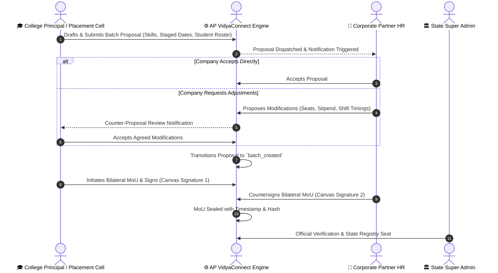
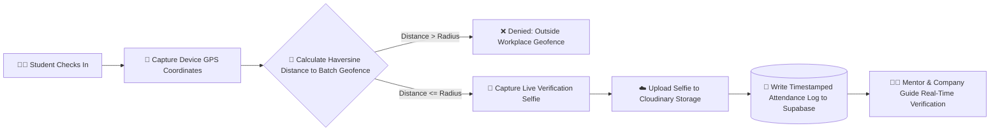

# 🎓 AP VidyaConnect (ఆంధ్రప్రదేశ్ విద్యాకనెక్ట్)
### State Unified Internship, Dual-Signature MoU & Industry Collaboration Platform
**An official digital initiative developed by PixelWind Technologies for the Department of Higher Education, Government of Andhra Pradesh.**

---

[](LICENSE)
[](https://reactjs.org/)
[](https://www.typescriptlang.org/)
[](https://tailwindcss.com/)
[](https://vitejs.dev/)
[](https://supabase.com/)
[](https://www.education.gov.in/nep)

---

## 🏛️ Executive Summary

**AP VidyaConnect** is a state-grade enterprise platform engineered to unify and govern the entire internship lifecycle across all **26 districts of Andhra Pradesh**. It connects higher educational institutions (universities, autonomous engineering colleges, polytechnics) with verified industrial enterprises, IT corporations, and research labs. 

The platform replaces fragmented paperwork with cryptographically sealed, immutable digital workflows:
- **Two-Sided Legal MoUs**: Legally binding bilateral MoUs with dual HTML5 canvas e-signatures.
- **Batch Proposal Builder**: Dynamic negotiation and counter-proposal state machine.
- **Haversine Geofenced Attendance**: GPS-verified radius checks (50m–1000m) with webcam selfie validation.
- **NEP 2020 Academic Credits**: Direct alignment with National Higher Education Qualification Framework (NHEQF Levels 4.5 to 8).
- **State Nodal Governance**: Super Admin oversight, entity registration audits, and real-time state dashboards.
- **VidyaBot AI**: 3D interactive intelligence assistant with voice synthesis and multi-module knowledge base.

---

## 🏗️ Platform System Architecture

```mermaid
flowchart TD
    subgraph Client Layer [🌐 Unified Client Layer (React 18 + TypeScript + Vite)]
        A1[🏛️ State Super Admin Portal]
        A2[🎓 College / Institution Admin Portal]
        A3[🏢 Corporate Industry Admin Portal]
        A4[🧑‍🏫 Faculty Mentor Workspace]
        A5[💼 Industry Guide Workspace]
        A6[🧑‍🎓 Enrolled Student Workspace]
        A7[🤖 VidyaBot 3D AI Assistant]
    end

    subgraph Security & Access [🔒 Security & Verification Engine]
        B1[Auth & RBAC State Machine]
        B2[DPDP Act 2023 Compliance & Audit Logs]
        B3[GPS Haversine Distance Geofence Engine]
        B4[Webcam Biometric Selfie Capture & Verification]
        B5[Dual-Party Canvas e-Signature Engine]
    end

    subgraph Backend & Cloud [⚡ Cloud Infrastructure]
        C1[(Supabase PostgreSQL Database)]
        C2[Row Level Security / RLS Policies]
        C3[PostgreSQL State Machine RPCs]
        C4[Deno Edge Functions]
        C5[Cloudinary Media & Signature Storage]
        C6[Resend Transactional Email Engine]
    end

    Client Layer --> Security & Access
    Security & Access --> Backend & Cloud
```

---

## 🔄 Core Workflow Pipelines

### 1. The Bilateral MoU & Proposal Negotiation State Machine



---

### 2. Geofenced Attendance & Biometric Verification Pipeline



---

## 👥 Multi-Portal Role Matrix

| Role | Portal Capabilities | Key Permissions |
| :--- | :--- | :--- |
| **🏛️ State Super Admin** | State-wide analytics, district aggregates, entity registration approvals, compliance dossier review, promotional banner manager, audit trails. | Full Platform Oversight, Entity Verification, Global Broadcasts |
| **🎓 Institution Admin** | Batch proposal builder, student roster CSV ingestion, MoU drafting, academic credit tracking, faculty coordinator assignments. | College Operations, MoU Execution, Academic Roster Management |
| **🏢 Company Admin** | Opportunity postings, proposal review & counter-negotiation, geofence parameter configuration (lat/lng/radius), industry mentor assignments. | Batch Acceptance, Workplace Geofencing, Mentor Supervision |
| **🧑‍🏫 Faculty Coordinator** | Student attendance register monitoring, weekly task review, academic credit evaluation, mentor sync. | Attendance Audit, Log Approval, College-Level Mentorship |
| **💼 Industry Mentor** | Daily task dispatch, live student attendance sign-off, workplace performance reviews, completion sign-off. | Task Assignment, Performance Scoring, Guide Sign-Off |
| **🧑‍🎓 Student / Intern** | One-tap geofenced check-in with selfie verification, daily logbook submission, task completion board, internship dossier. | Attendance Check-in, Task Submission, Logbook Entry |

---

## 🚀 Key Modules & Capabilities

### 📍 Intelligent Geofence & Shift Configuration
- **Visual Interactive Map**: Satellite map with real-time radius circles (50m to 1000m) and draggable center coordinates.
- **Smart Shift Constraints**: Configurable check-in start/end windows, grace periods, half-day cutoffs, and weekly off presets (5-day, 6-day, custom shifts).
- **Anti-Spoofing Telemetry**: Strict device accuracy validation, browser geolocation permissions, and biometric webcam selfie capture.

### 📜 Dual-Signature MoU Document Engine
- **Formal Legal Templates**: Incorporates standard AICTE and AP Higher Education Department regulatory clauses.
- **HTML5 Canvas Signature Capture**: Smooth, pressure-sensitive desktop and touch signature drawing.
- **Automated Signature Extraction**: Smart canvas cropping and transparent background optimization.
- **Instant PDF Export & Email**: Generates official print-ready PDF legal documents and dispatches verified email notifications.

### 📊 NEP 2020 Credit Framework Engine
- **NHEQF Alignment**: Maps internship hours (60 to 480+ clock hours) to semester credits (2 to 16 credits).
- **Continuous Evaluation Matrix**: 4-part scoring rubric (Attendance 30%, Industry Guide Review 30%, Logbook Quality 20%, Final Defense 20%).

### 🤖 VidyaBot 3D AI Assistant
- **20 Integrated Knowledge Modules**: Comprehensive knowledge covering state policies, registration guides, geofence troubleshooting, and NEP credit formulas.
- **Interactive Speech Synthesis**: Built-in voice assistant with text-to-speech feedback.
- **Interactive Credit Calculator**: Instant interactive slider to calculate academic credits based on internship duration and weekly hours.
- **GPS Coordinates & Geofence Simulator**: Live interactive tool to test and verify workplace coordinates.

### 🖼️ Dynamic Promotional Banner Engine
- **Multi-Role Visibility Targeting**: Banners can be targeted globally or specifically to Students, Colleges, or Companies.
- **Tiered Carousel**: Hero banners, district nodal broadcasts, and upcoming hiring drives with automated transitions and interactive action links.

---

## 💻 Technology Stack

### Frontend
- **Framework**: React 18.3 (Single Page Application)
- **Language**: TypeScript 5.5 (Strict Type Checking)
- **Styling**: TailwindCSS 3.4 (Custom Andhra Pradesh State palette `#0E2350` & `#F07421`)
- **Icons**: Lucide React
- **Routing**: React Router DOM v6
- **Canvas / Media**: HTML5 Canvas API, WebRTC MediaStream Camera API
- **Build Tool**: Vite 5.4 with Rollup optimization

### Backend & Cloud Infrastructure
- **Database**: Supabase PostgreSQL with Row Level Security (RLS)
- **Edge Functions**: Deno TypeScript Edge Handlers
- **Media CDN**: Cloudinary REST API (Secure asset storage & signature rendering)
- **Email Delivery**: Resend API (Transactional notification dispatch)

---

## 📂 Project Directory Structure

```text
disha/
├── public/                     # Static brand assets, logos & official banners
│   ├── brand/                  # AP VidyaConnect SVG/PNG logos
│   └── images/                 # High-resolution platform imagery & 3D bot assets
├── src/
│   ├── components/             # Reusable UI components
│   │   ├── admin/              # Banner manager, verification modals
│   │   ├── attendance/         # Geofence map, webcam selfie modal
│   │   ├── batches/            # Batch activation, progress & email log modals
│   │   ├── common/             # VidyaBot, BrandLogo, Government Background, Cards
│   │   ├── layout/             # Header, Sidebar, Footer, PublicLayout, AppLayout
│   │   ├── mou/                # MoU document viewer, canvas signature modals
│   │   └── notifications/      # Notification toaster & dropdown center
│   ├── context/                # React Contexts (AuthContext, NotificationContext, ModalContext)
│   ├── data/                   # Initial seed data for AP districts, institutions & companies
│   ├── pages/                  # Routed platform views
│   │   ├── admin/              # Super Admin dashboard, entity directories, audit logs
│   │   ├── attendance/         # Attendance register & daily logs
│   │   ├── auth/               # Login, Register, Change Password pages
│   │   ├── batches/            # Batch list, batch workspace, geofence settings
│   │   ├── company/            # Postings, industry mentors, attendance settings
│   │   ├── dashboard/          # Role-based dashboard router & views
│   │   ├── evaluations/        # Academic & industry scoring registers
│   │   ├── institution/        # Faculty coordinator rosters
│   │   ├── mou/                # MoU listings, creation & detail pages
│   │   ├── notifications/      # Notification center
│   │   ├── profile/            # User & entity profile settings
│   │   ├── proposals/          # Proposal builder, negotiation decisions, detail views
│   │   ├── public/             # Public landing, opportunities, partners, colleges, FAQ, terms
│   │   ├── students/           # Student management & student workspace
│   │   └── tasks/              # Daily task assignment & submission board
│   ├── services/               # API clients, Cloudinary service, DB Store, Supabase
│   ├── types/                  # TypeScript database contracts & entity models
│   ├── utils/                  # Signature extractor, credentials dossier, geofence helpers
│   ├── App.tsx                 # Main application router
│   ├── index.css               # Design system tokens & global styling
│   └── main.tsx                # Application mount point
├── supabase/
│   ├── functions/              # Deno Edge Functions (Batch activation, Cloudinary, Resend)
│   └── migrations/             # SQL schemas, RLS policies, State Machine RPCs
├── tailwind.config.js          # Tailwind CSS theme extension
├── tsconfig.json               # TypeScript configuration
└── vite.config.ts              # Vite configuration
```

---

## 🛠️ Local Development Setup

### Prerequisites
- **Node.js**: `v18.0.0` or higher
- **npm**: `v9.0.0` or higher
- **Git**

### Installation Steps

1. **Clone the Repository:**
   ```bash
   git clone https://github.com/jasimmushtaq/AP-Vidyaconnect-.git
   cd AP-Vidyaconnect-
   ```

2. **Install Dependencies:**
   ```bash
   npm install
   ```

3. **Configure Environment Variables:**
   Create a `.env` file in the project root:
   ```env
   VITE_SUPABASE_URL=your_supabase_project_url
   VITE_SUPABASE_ANON_KEY=your_supabase_anon_key
   VITE_CLOUDINARY_CLOUD_NAME=your_cloudinary_cloud_name
   VITE_CLOUDINARY_UPLOAD_PRESET=your_unsigned_preset
   ```

4. **Start Development Server:**
   ```bash
   npm run dev
   ```
   Access the platform locally at `http://localhost:3000` (or `http://localhost:5173`).

5. **Build for Production:**
   ```bash
   npm run build
   ```

---

## 🛡️ Security & Compliance Standards

- **DPDP Act 2023 Compliance**: Zero third-party data monetization; strict consent models and encryption of student academic and biometric telemetry.
- **Row Level Security (RLS)**: PostgreSQL-enforced multi-tenant isolation ensuring colleges, companies, and students only query authorized rows.
- **State Machine RPC Isolation**: Sensitive proposal transitions and batch activations are executed via validated PostgreSQL stored procedures (`SECURITY DEFINER`).

---

## 📞 Support & Institutional Contact

- **Operating Desk**: Andhra Pradesh Higher Education Nodal Desk
- **Technical Operations**: PixelWind Technologies Corporate Headquarters
- **Official Phone / WhatsApp**: `+91 93989 29970`
- **Official Email**: `pixelwindtechnologies@gmail.com`
- **Corporate Portal**: [www.pixelwindtechnologies.com](https://www.pixelwindtechnologies.com/)

---

*© 2026 Government of Andhra Pradesh • Higher Education Department & PixelWind Technologies. All rights reserved.*
